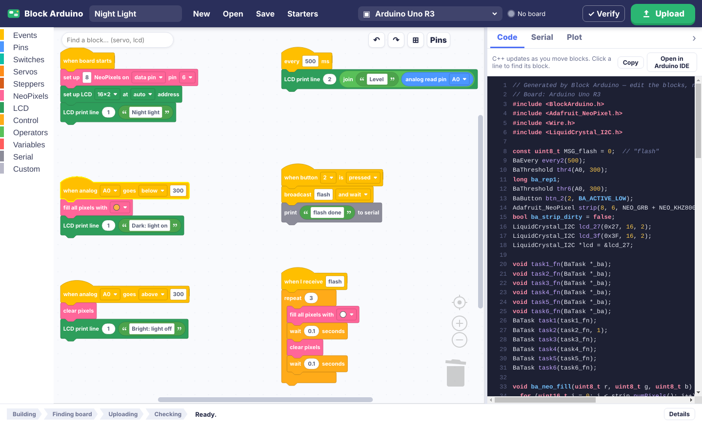

# Block Arduino

Program an Arduino by snapping blocks together, like Scratch, and click one button to get working code on the board.



- **Events, not loops.** Every script starts with a hat block ("when board starts", "when button pressed", "every 500 ms") and scripts run side by side. A `wait` in one script never pauses another.
- **One-click Smart Upload.** Finds the USB port and board by itself, and when an upload fails it reads the error, changes one setting and retries.
- **Always see the C++.** A live code panel shows the generated sketch; click a line to find the block that made it.
- **Custom blocks.** Drop in raw C++, or build reusable blocks with the Block Maker.

**Downloads and every version:** see the project's GitHub Pages site (Settings → Pages) or the [Releases](../../releases) page.

## Run from source

```bash
npm install
npm run fetch-cli        # downloads arduino-cli for your OS into vendor/
npm start
```

Requires Node.js 20+. Board support (e.g. Arduino AVR, ~150 MB) installs the first time you build for a board; after that everything works offline.

## Tests

```bash
npm test
```

Runs three suites:

1. `test/generate.js` generates C++ for every starter project.
2. `test/unit.js` checks Smart Upload error classification, board ranking and custom blocks.
3. `test/sim/run.sh` compiles the generated sketches with `g++` against a mock Arduino core and checks timing: for example, that a button press is debounced in 20 ms while another script keeps blinking, and that "broadcast and wait" resumes exactly when the receiving script finishes.

## Releasing a new version

Releases are built by GitHub Actions on real macOS, Windows and Linux machines.

1. Bump `version` in `package.json` (e.g. `0.2.0`).
2. Add a `## [0.2.0] - YYYY-MM-DD` section at the top of `CHANGELOG.md`. It becomes the release notes.
3. Commit, then tag and push:
   ```bash
   git commit -am "Release 0.2.0"
   git tag v0.2.0
   git push origin main --tags
   ```
4. The **Build and release** workflow tests, packages all platforms and publishes the GitHub Release. The downloads page lists it automatically.

Pushes to `main` and pull requests also build all platforms (as workflow artifacts) without publishing.

## Project layout

| Path | What it is |
| --- | --- |
| `src/main/` | Electron main process: window, menus, IPC, `arduino.js` (build service around arduino-cli), `smart-upload.js` |
| `src/renderer/` | UI: `blocks.js` (block definitions + toolbox), `generator.js` (blocks → C++ + source map), `custom-blocks.js`, `starters.js`, `app.js` |
| `src/shared/boards.js` | Board profiles: FQBN, USB IDs, pin maps, Smart Upload alternatives |
| `resources/libraries/BlockArduino/` | `BlockArduino.h` runtime: protothread tasks, debounced buttons, edges, thresholds, broadcasts |
| `docs/` | GitHub Pages downloads and version history site |
| `tools/fetch-arduino-cli.js` | Fetches the arduino-cli binary bundled into each package |

## Custom block format

```json
{
  "id": "buzzer_beep",
  "shape": "statement",
  "label": "beep buzzer on pin %PIN for %MS ms",
  "inputs": {
    "PIN": { "type": "pin", "default": 8, "filter": "digital" },
    "MS":  { "type": "number", "default": 200 }
  },
  "setup": "pinMode({{PIN}}, OUTPUT);",
  "code": "tone({{PIN}}, 1000, {{MS}});",
  "libraries": []
}
```

Input types: `number`, `text`, `pin`, `dropdown`, `colour`, `boolean`, `statements`. Use `{{WAIT_MS:100}}` in `code` to pause without blocking other scripts. Save blocks as `.bablock` files, or ship a folder with `extension.json` and `blocks/*.json`.

## Licence

MIT. Bundles [arduino-cli](https://github.com/arduino/arduino-cli) (GPL-3.0) as a separate executable, and uses [Blockly](https://github.com/google/blockly) (Apache-2.0) and [Electron](https://www.electronjs.org/) (MIT).
